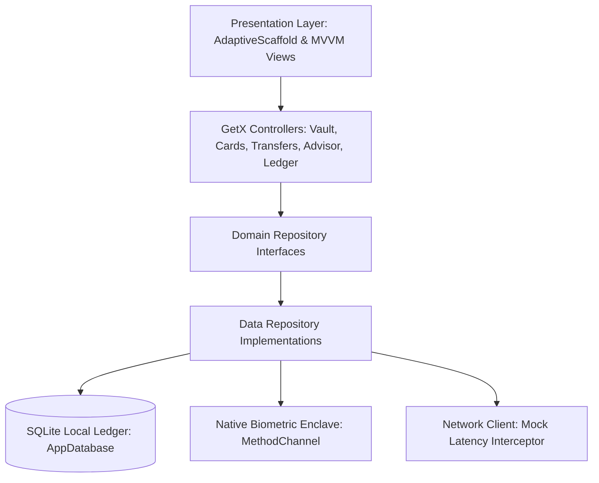
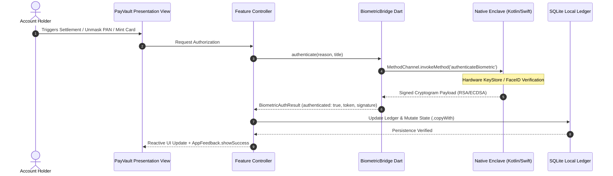

# PayVault - Enterprise FinTech Neo-Bank & Multi-Currency Digital Vault

[](https://github.com/Safeer-Hussain/payvault/actions)
[](https://flutter.dev)
[](https://dart.dev)
[]()

PayVault is a next-generation enterprise FinTech neo-bank, multi-currency liquidity vault, frosted virtual card studio, native hardware KeyStore enclave bridge, and on-device AI financial copilot engineered in Flutter. Built with Swiss private banking precision, it delivers offline-first resilience via local SQLite, cryptographic hardware signature authorization, zero hardcoded colors, and complete immunity to viewport RenderFlex overflow.

---

## Architecture Overview

PayVault enforces a strict Feature-First Clean Architecture + MVVM design pattern paired with GetIt for dependency injection and GetX for reactive state management.



### Native Biometric & KeyStore Bridge Sequence



---

## Core Production Modules

| Module | Core Capabilities | Security & Architectural Highlights |
|---|---|---|
| **Multi-Currency Vault** | Real-time liquidity across USD, EUR, GBP, PKR, and AED with automatic net worth aggregation and transparent 0.1% FX swap calculation. | Full-width edge-to-edge `fl_chart` cash flow graphs, zero hardcoded colors, reactive theme parity. |
| **Virtual Card Studio** | 3D frosted glass card carousel (Titanium Black, Platinum Cyber, Emerald Eco, Rose Gold Luxe) with monthly spend cap sliders ($500 to $10,000) and online/ATM toggles. | Biometric-protected tap-to-reveal for 16-digit PAN/CVV; 1-tap instant card freezing with frosted blur overlay. |
| **Instant Settlement Engine** | Verified payee roster with quick chips, dynamic merchant contactless QR generator, and interactive terminal scanner simulator. | Smart bill-splitting calculator supporting 2 to 6 participants with automated split ratio rebalancing. |
| **AI Financial Intelligence** | On-device financial advisory copilot evaluating local SQLite cash flow history, burn velocity, and quarterly runway. | Token-by-token streaming response strictly guarded by `try ... finally` lifecycle cleanup guarantees. |
| **Ledger & Audit Hub** | Searchable and filterable transaction audit ledger with category badges, spending doughnut chart, and weekly burn bar chart. | Simulated cryptographic PDF receipt generation with SHA-256 seal verification. |
| **Recruiter Debug Hub** | Sliding developer drawer accessible via terminal icon or long-press on app title. | Latency injection slider (200ms - 2000ms), HTTP 503 outage toggle, and mock wire deposit injector. |

---

## Physical Device Startup & Impeller Resilience

- **Android SDK 36 Compatibility**: `compileSdk = 36`, `targetSdk = 36`, and `minSdk = 21` configured in `android/app/build.gradle.kts` to eliminate AndroidX 1.18+ AAR metadata compile exceptions.
- **Impeller Vulkan Crash Protection**: Disabled Impeller Vulkan fallback on MediaTek and Mali GPUs via Android manifest configuration (`EnableImpeller: false`).
- **Defensive Main Entry**: Initialized inside `runZonedGuarded` with global `FlutterError.onError` capture. Heavy database migrations and image precaching deferred until after the first frame render in `SplashView`.

---

## Verification & Sprint Gatekeeper

PayVault includes a standalone gatekeeper script enforcing clean architecture and zero-warning rules across four verification phases:

```bash
# Run the standalone sprint gatekeeper
dart run tool/sprint_gate.dart
```

```text
[Phase 1/4] Executing: Flutter Pub Get... (Passed)
[Phase 2/4] Executing: Dart Code Formatting (lib, test)... (Passed)
[Phase 3/4] Executing: Flutter Analyze (Zero Warning Rule)... (Passed)
[Phase 4/4] Executing: Flutter Automated Tests (20 tests passed)... (Passed)
```

---

## Automated Test Suite

PayVault features 20 automated unit and widget tests covering:
- Currency conversion math and transparent 0.1% FX fee calculation.
- Card freezing state transitions and spending limit validation.
- P2P wire transfers with biometric signature token injection and wallet deduction.
- AI token streaming and guaranteed state reset upon completion.
- Multi-tab navigation shell with zero duplicate Hero tag exceptions.
- 800x360 landscape viewport layout with zero RenderFlex overflow.
- Dynamic theme switching between Obsidian Gold Dark and Swiss Ivory Light modes.

```bash
flutter test
```

---

## Clean-Room NDA Disclaimer

This repository is developed as a showcase implementation of enterprise mobile FinTech architecture, local cryptographic enclaves, and reactive Clean Architecture. All banking rails, KeyStore bridges, and mock endpoints operate purely offline via simulated cryptographic tokens and local SQLite storage. No proprietary external APIs or client credentials are incorporated.
